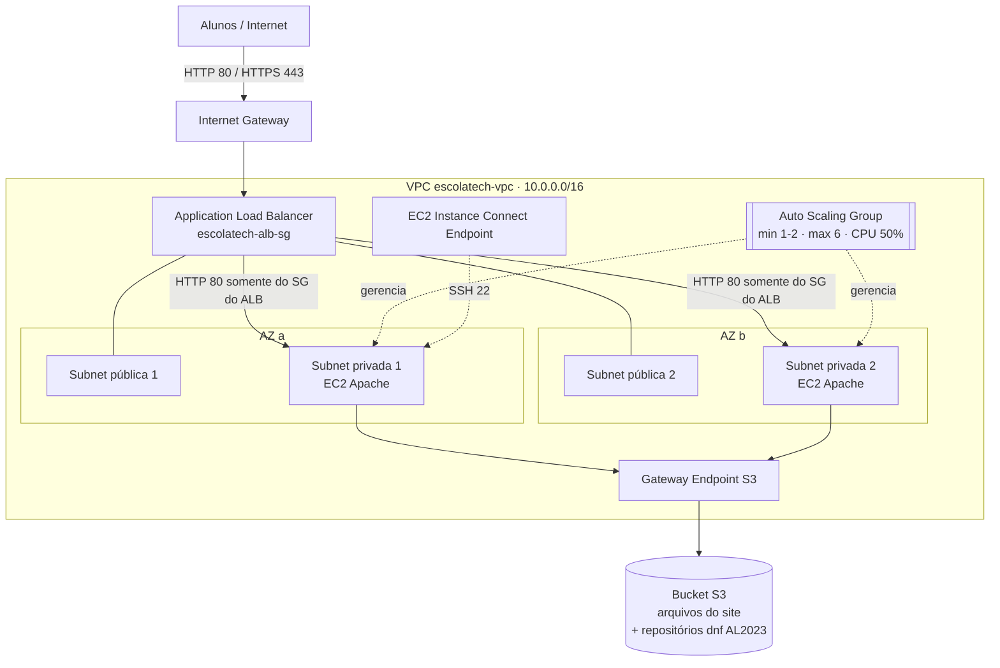

# Escola Tech: passo a passo no Console AWS

Guia para criar, pelo Console AWS, a infraestrutura do site de matrículas da Escola Tech:
ALB + EC2 Auto Scaling em duas Availability Zones, dentro de uma VPC com servidores em subnets privadas.

---

## 0. Antes de começar

### 0.1 Arquitetura



| Componente | Função no case |
|---|---|
| VPC com 2 subnets públicas + 2 privadas em 2 AZs | Se uma AZ falhar, a outra continua atendendo. |
| ALB nas subnets públicas | Único ponto exposto à internet. Distribui requisições e faz health check. |
| EC2 nas subnets privadas (sem IP público) | Servidores só recebem tráfego vindo do ALB. |
| Auto Scaling Group | Cria e remove instâncias pela CPU (elasticidade) e por horário (madrugada × horário comercial). Substitui instâncias que falham no health check. |
| Bucket S3 privado | Guarda os arquivos do site. Cada instância nova baixa o site no boot. |
| Gateway Endpoint de S3 (gratuito) | Permite às instâncias privadas acessar o S3 (site e pacotes `dnf` do Amazon Linux 2023) **sem NAT Gateway**, que custaria cerca de US$ 33/mês. |
| EC2 Instance Connect Endpoint (gratuito) | Acesso SSH pelo console às instâncias privadas, sem bastion e sem chave `.pem`, para os testes. |

### 0.2 Pré-requisitos

- Conta AWS com permissão de administrador.
- Os arquivos deste projeto:
  - `site/` (frontend)
  - `infra/user-data.sh` (script de inicialização das instâncias)
  - `infra/iam-policy-s3-read.json` (permissão de leitura do bucket)

### 0.3 Região e nomes

Escolha **uma região** e use-a em todos os passos (canto superior direito do console). Os exemplos usam
`us-east-1` (N. Virginia), que costuma ser a mais barata. `sa-east-1` (São Paulo) dá menor latência para alunos no Brasil, mas custa mais.

Nomes usados no guia (mantenha-os para facilitar):

| Recurso | Nome |
|---|---|
| VPC (prefixo do assistente) | `escolatech` |
| SG do ALB | `escolatech-alb-sg` |
| SG das instâncias | `escolatech-web-sg` |
| SG do Instance Connect Endpoint | `escolatech-eice-sg` |
| Bucket S3 | `escolatech-site-<ID-DA-CONTA>` (precisa ser único no mundo) |
| IAM Role | `EscolaTech-EC2-Role` |
| Launch Template | `lt-escolatech-web` |
| Target Group | `tg-escolatech-web` |
| Load Balancer | `alb-escolatech` |
| Auto Scaling Group | `asg-escolatech-web` |

> A AWS não aceita nomes de Security Group começando com `sg-` (prefixo reservado aos IDs, como `sg-0abc123...`). Por isso os grupos terminam em `-sg`.

### 0.4 Custo estimado (us-east-1, valores aproximados)

| Item | Cálculo | US$/mês |
|---|---|---|
| ALB (hora) | US$ 0,0225/h × 730 h | ~16,40 |
| ALB (LCU, tráfego baixo) | ~1 LCU × US$ 0,008/h × 730 h | ~5,80 |
| IPv4 público do ALB | 2 IPs × US$ 0,005/h × 730 h | ~7,30 |
| EC2 t3.micro com agendamento | 1 instância 24/7 + 1 extra no horário comercial (~1.100 h × US$ 0,0104) | ~11,50 |
| EBS gp3 8 GiB | 2 × 8 GiB × US$ 0,08 | ~1,30 |
| Monitoramento detalhado (opcional) | 7 métricas × US$ 0,30 por instância | ~3,00 |
| Gateway Endpoint S3, Instance Connect Endpoint | gratuitos | 0 |
| S3 (poucos MB) | | < 0,10 |
| **Total aproximado** | | **~45** |

Confira os valores atuais na [AWS Pricing Calculator](https://calculator.aws/). O Free Tier da sua conta pode cobrir parte do EC2 e do ALB.
**Ao terminar os estudos, siga a seção 14 (Limpeza)**, porque o ALB cobra por hora mesmo sem tráfego.

---

## 1. VPC (rede em duas AZs)

O assistente "VPC and more" cria VPC, subnets, route tables, Internet Gateway e o endpoint de S3 de uma vez.

1. Console → **VPC** → **Your VPCs** → **Create VPC**.
2. **Resources to create**: `VPC and more`.
3. **Name tag auto-generation**: marque *Auto-generate* e digite `escolatech`.
4. **IPv4 CIDR block**: `10.0.0.0/16`.
5. **IPv6 CIDR block**: `No IPv6 CIDR block`.
6. **Tenancy**: `Default`.
7. **Number of Availability Zones (AZs)**: `2`.
8. **Number of public subnets**: `2`.
9. **Number of private subnets**: `2`.
10. (Opcional) **Customize subnets CIDR blocks**: os padrões servem. Exemplo:
    - pública 1: `10.0.0.0/20`, pública 2: `10.0.16.0/20`
    - privada 1: `10.0.128.0/20`, privada 2: `10.0.144.0/20`
11. **NAT gateways**: `None`. As instâncias não precisam de internet; o S3 resolve tudo.
12. **VPC endpoints**: `S3 Gateway`.
13. **DNS options**: marque **Enable DNS hostnames** e **Enable DNS resolution**.
14. **Create VPC** e aguarde todos os itens ficarem verdes.

**Conferência**

- **Subnets**: 4 subnets `escolatech-subnet-public1-...`, `public2`, `private1`, `private2`, em duas AZs diferentes.
- **Route tables**: as tabelas `escolatech-rtb-private1-...` e `private2` devem ter uma rota para `pl-xxxxxxxx` (prefix list do S3) com destino `vpce-...`. Sem essa rota, o `dnf` e o download do site falham.
- A tabela `escolatech-rtb-public` deve ter `0.0.0.0/0 → igw-...`.

---

## 2. Security Groups

Ordem: crie os três grupos e depois ajuste as regras que referenciam outros grupos.

Console → **EC2** → **Network & Security** → **Security Groups** → **Create security group**. Em todos, selecione a VPC `escolatech-vpc`.

### 2.1 `escolatech-alb-sg` (Load Balancer)

- **Description**: `ALB - aceita HTTP/HTTPS da internet`
- **Inbound rules**:

  | Type | Port | Source |
  |---|---|---|
  | HTTP | 80 | `Anywhere-IPv4` (0.0.0.0/0) |
  | HTTPS | 443 | `Anywhere-IPv4` (0.0.0.0/0) |

- **Outbound rules**: deixe o padrão por enquanto (será restringido no passo 2.4).
- **Create security group**.

### 2.2 `escolatech-eice-sg` (Instance Connect Endpoint)

- **Description**: `EC2 Instance Connect Endpoint - SSH para as instancias`
- **Inbound rules**: nenhuma.
- **Outbound rules**: remova a regra padrão (será criada no passo 2.4).
- **Create security group**.

### 2.3 `escolatech-web-sg` (instâncias EC2)

- **Description**: `Web - aceita HTTP somente do ALB`
- **Inbound rules**:

  | Type | Port | Source |
  |---|---|---|
  | HTTP | 80 | `Custom` → `escolatech-alb-sg` |
  | SSH | 22 | `Custom` → `escolatech-eice-sg` |

- **Outbound rules**: mantenha `All traffic → 0.0.0.0/0`. As instâncias precisam de HTTPS de saída para o S3; como não há NAT, esse tráfego só alcança o S3 pelo endpoint.
- **Create security group**.

> O ponto de atenção do case está na regra HTTP 80: a origem é o **Security Group do ALB**, não um IP. Nenhum computador da internet consegue chegar direto nas instâncias.

### 2.4 Ajustar as saídas (menor privilégio)

1. Abra `escolatech-alb-sg` → **Outbound rules** → **Edit outbound rules**:
   remova `All traffic` e adicione `HTTP | 80 | Custom → escolatech-web-sg`. **Save rules**.
   (O ALB só precisa falar com as instâncias na porta 80, tanto para tráfego quanto para o health check.)
2. Abra `escolatech-eice-sg` → **Outbound rules** → **Edit outbound rules**:
   adicione `SSH | 22 | Custom → escolatech-web-sg`. **Save rules**.

---

## 3. Bucket S3 com o site

1. Console → **S3** → **Create bucket**.
2. **Bucket type**: `General purpose`.
3. **Bucket name**: `escolatech-site-<ID-DA-CONTA>` (ID de 12 dígitos no menu da conta, canto superior direito).
4. **Object Ownership**: `ACLs disabled`.
5. **Block Public Access**: mantenha **Block all public access** marcado. O bucket é privado; só as instâncias leem.
6. **Default encryption**: `SSE-S3` (padrão).
7. **Create bucket**.
8. Abra o bucket → **Upload**:
   - **Add files**: selecione `site/index.html`.
   - **Add folder**: selecione a pasta `site/assets`.
   - Resultado na raiz do bucket: `index.html` e `assets/...` (css, js, img).
   - **Upload**.

> Não envie a pasta `site` em si; o `index.html` precisa ficar na **raiz** do bucket.

Anote o nome do bucket. Ele será usado nos passos 4 e 5.

---

## 4. IAM Role das instâncias

Permite que as instâncias leiam o bucket sem chaves de acesso.

1. Console → **IAM** → **Roles** → **Create role**.
2. **Trusted entity type**: `AWS service`. **Use case**: `EC2` → **Next**.
3. Em **Add permissions**, não selecione nada → **Next**.
4. **Role name**: `EscolaTech-EC2-Role` → **Create role**.
5. Abra a role → **Add permissions** → **Create inline policy** → aba **JSON**.
6. Cole o conteúdo de `infra/iam-policy-s3-read.json`, trocando as **duas** ocorrências de `SUBSTITUA-PELO-NOME-DO-BUCKET` pelo nome do seu bucket.
7. **Next** → **Policy name**: `LeituraBucketSite` → **Create policy**.

Ao criar a role pelo caso de uso EC2, o console cria também o *instance profile* com o mesmo nome, que é o que o Launch Template usa.

---

## 5. Launch Template (modelo das instâncias)

1. Console → **EC2** → **Instances** → **Launch Templates** → **Create launch template**.
2. **Launch template name**: `lt-escolatech-web`.
3. **Template version description**: `v1 - Apache + site do S3`.
4. Marque **Provide guidance to help me set up a template that I can use with EC2 Auto Scaling**.
5. **Application and OS Images**: aba **Quick Start** → **Amazon Linux** → `Amazon Linux 2023 AMI` (arquitetura **64-bit (x86)**).
   Use a AMI padrão, não a *minimal*: o script depende do AWS CLI, que vem instalado na padrão.
6. **Instance type**: `t3.micro`.
7. **Key pair**: `Don't include in launch template`. O acesso de teste será pelo Instance Connect Endpoint.
8. **Network settings**:
   - **Subnet**: `Don't include in launch template` (o Auto Scaling escolhe).
   - **Firewall (security groups)**: `Select existing security group` → `escolatech-web-sg`.
9. **Storage**: mantenha o padrão (8 GiB gp3).
10. **Resource tags**: adicione `Key: Project`, `Value: escola-tech`, aplicado a *Instances* e *Volumes*.
11. Expanda **Advanced details**:
    - **IAM instance profile**: `EscolaTech-EC2-Role`.
    - **Detailed CloudWatch monitoring**: `Enable`. Opcional, cerca de US$ 2/instância/mês. Com ele a métrica de CPU chega a cada 1 minuto e o Auto Scaling reage em poucos minutos; sem ele, a cada 5 minutos.
    - **Credit specification**: `Standard`. Instâncias T3 nascem em modo *Unlimited*, que cobra extra quando a CPU fica alta por muito tempo, como no teste de carga do passo 10.
    - **Metadata accessible**: `Enabled`.
    - **Metadata version**: `V2 only (token required)`.
    - **User data**: cole o conteúdo de `infra/user-data.sh` e troque `SUBSTITUA-PELO-NOME-DO-BUCKET` pelo nome do bucket.
12. **Create launch template**.

O que o user data faz em cada instância nova:

1. Lê ID, AZ e IP da instância pelo IMDSv2.
2. Instala o Apache (`dnf install httpd`) pelo endpoint de S3.
3. Baixa o site com `aws s3 sync`.
4. Grava `/instance.json`, exibido no rodapé do site (mostra qual servidor respondeu).
5. Grava `/health` por último. Se algo falhar antes, o health check falha e o Auto Scaling troca a instância.

---

## 6. Target Group (destino do ALB + health check)

1. Console → **EC2** → **Load Balancing** → **Target Groups** → **Create target group**.
2. **Target type**: `Instances`.
3. **Target group name**: `tg-escolatech-web`.
4. **Protocol : Port**: `HTTP : 80`.
5. **IP address type**: `IPv4`.
6. **VPC**: `escolatech-vpc`.
7. **Protocol version**: `HTTP1`.
8. **Health checks**:
   - **Health check protocol**: `HTTP`
   - **Health check path**: `/health`
   - Expanda **Advanced health check settings**:

     | Campo | Valor | Por quê |
     |---|---|---|
     | Port | `Traffic port` | |
     | Healthy threshold | `2` | 2 respostas OK para entrar em serviço |
     | Unhealthy threshold | `2` | 2 falhas para sair de serviço |
     | Timeout | `5` s | |
     | Interval | `10` s | Detecta falha em cerca de 20 s |
     | Success codes | `200` | |

9. **Next**. Na tela **Register targets**, não registre nada (o Auto Scaling fará isso) → **Create target group**.
10. Abra o target group → aba **Attributes** → **Edit**:
    - **Deregistration delay**: `30` segundos (padrão 300). Instâncias removidas pelo scale-in saem mais rápido.
    - **Save changes**.

---

## 7. Application Load Balancer

1. Console → **EC2** → **Load Balancers** → **Create load balancer** → **Application Load Balancer** → **Create**.
2. **Load balancer name**: `alb-escolatech`.
3. **Scheme**: `Internet-facing`.
4. **Load balancer IP address type**: `IPv4`.
5. **Network mapping**:
   - **VPC**: `escolatech-vpc`.
   - **Availability Zones and subnets**: marque **as duas AZs** e, em cada uma, escolha a subnet **pública** (`escolatech-subnet-public1-...` e `public2-...`).
6. **Security groups**: remova o `default` e selecione `escolatech-alb-sg`.
7. **Listeners and routing**:
   - **Protocol**: `HTTP`, **Port**: `80`.
   - **Default action**: `Forward to target groups` → `tg-escolatech-web`.
8. Deixe as demais opções no padrão → **Create load balancer**.
9. Aguarde o **State** mudar de `Provisioning` para `Active` (alguns minutos). Copie o **DNS name**, algo como `alb-escolatech-123456789.us-east-1.elb.amazonaws.com`.

Por enquanto o endereço responde `503`, porque ainda não há instâncias.

---

## 8. Auto Scaling Group

1. Console → **EC2** → **Auto Scaling** → **Auto Scaling Groups** → **Create Auto Scaling group**.

**Passo 1: Choose launch template**

2. **Name**: `asg-escolatech-web`.
3. **Launch template**: `lt-escolatech-web`, **Version**: `Latest`. → **Next**.

**Passo 2: Choose instance launch options**

4. **VPC**: `escolatech-vpc`.
5. **Availability Zones and subnets**: selecione as duas subnets **privadas** (`private1` e `private2`).
6. **Availability Zone distribution**: `Balanced best effort`. → **Next**.

**Passo 3: Integrate with other services**

7. **Load balancing**: `Attach to an existing load balancer` → `Choose from your load balancer target groups` → `tg-escolatech-web | HTTP`.
8. **VPC Lattice**: `No VPC Lattice service`.
9. **Health checks**:
   - Marque **Turn on Elastic Load Balancing health checks**.
   - **Health check grace period**: `180` segundos (tempo para o user data instalar o Apache e baixar o site).
10. **Next**.

> Esse checkbox fecha o ciclo de Health Checks do case. Sem ele, o ALB para de mandar tráfego para a instância doente, mas o Auto Scaling não a substitui (por padrão ele só olha o status da EC2, não o da aplicação).

**Passo 4: Configure group size and scaling**

11. **Desired capacity**: `2`.
12. **Min desired capacity**: `2`. **Max desired capacity**: `6`.
13. **Automatic scaling**: `Target tracking scaling policy`.
    - **Scaling policy name**: `cpu-50`.
    - **Metric type**: `Average CPU utilization`.
    - **Target value**: `50`.
    - **Instance warmup**: `120` segundos.
    - Deixe **Disable scale in** desmarcado (o grupo precisa encolher).
14. **Instance maintenance policy**: `Prioritize availability` (cria a nova instância antes de terminar a antiga).
15. **Additional settings**:
    - Marque **Enable group metrics collection within CloudWatch** (gráficos de quantas instâncias existem ao longo do tempo).
    - **Default instance warmup**: marque e use `120` segundos.
16. **Next**.

**Passo 5: Add notifications**: pule (**Next**). Se quiser e-mail a cada scale-out/in, crie um tópico SNS aqui.

**Passo 6: Add tags**

17. **Add tag**: `Key: Name`, `Value: escolatech-web`, com **Tag new instances** marcado. → **Next**.

**Passo 7: Review**

18. **Create Auto Scaling group**.

**Conferência (3 a 5 minutos depois)**

- **EC2 → Instances**: duas instâncias `escolatech-web`, uma em cada AZ, **sem IP público**.
- **Target Groups → tg-escolatech-web → Targets**: as duas como `healthy`.
- Abra `http://<DNS-do-ALB>` no navegador. O site aparece e o rodapé mostra *Servido por i-xxxx · AZ us-east-1a*. Clique em **atualizar** algumas vezes: o ID e a AZ alternam entre as instâncias.

Se os targets ficarem `unhealthy`, veja a seção 13 (Solução de problemas).

---

## 9. Elasticidade por horário (encolher na madrugada, esticar no horário comercial)

A política `cpu-50` reage à carga. As ações agendadas mudam os limites do grupo conforme o relógio, para economizar quando quase ninguém acessa.

Console → **Auto Scaling Groups** → `asg-escolatech-web` → aba **Automatic scaling** → **Scheduled actions** → **Create scheduled action**.

### 9.1 `encolher-madrugada`

| Campo | Valor |
|---|---|
| Name | `encolher-madrugada` |
| Desired capacity | `1` |
| Min | `1` |
| Max | `3` |
| Recurrence | `Cron` → `0 0 * * *` (todo dia às 00:00) |
| Time zone | `America/Sao_Paulo` |

### 9.2 `esticar-horario-comercial`

| Campo | Valor |
|---|---|
| Name | `esticar-horario-comercial` |
| Desired capacity | `2` |
| Min | `2` |
| Max | `6` |
| Recurrence | `Cron` → `0 7 * * 1-5` (segunda a sexta às 07:00) |
| Time zone | `America/Sao_Paulo` |

Como funciona na prática:

- Das 00:00 às 07:00 (e nos fins de semana) o grupo roda com 1 instância. Se uma campanha gerar pico de madrugada, a política de CPU ainda pode subir até 3.
- Nos dias úteis, a partir das 07:00, o mínimo volta a 2 (uma por AZ) e o grupo pode chegar a 6 nos picos de campanha.
- Durante o dia, a política `cpu-50` adiciona instâncias quando a média passa de 50% e remove quando cai.

> **Trade-off:** com 1 instância na madrugada, uma falha de AZ deixa o site fora do ar por alguns minutos, até o Auto Scaling subir uma instância na outra AZ. Se a Escola Tech não aceitar isso, use `Min 2` também na madrugada (custo extra de ~US$ 3,75/mês em t3.micro, referente às ~360 horas mensais de madrugada e fim de semana).

---

## 10. Testes do case

### 10.1 Criar o EC2 Instance Connect Endpoint (para acessar as instâncias privadas)

1. Console → **VPC** → **PrivateLink and Lattice** → **Endpoints** → **Create endpoint**.
2. **Name tag**: `eice-escolatech`.
3. **Type**: `EC2 Instance Connect Endpoint`.
4. **VPC**: `escolatech-vpc`.
5. **Security groups**: `escolatech-eice-sg`.
6. **Subnet**: `escolatech-subnet-private1-...`. Um endpoint alcança instâncias de todas as subnets da VPC.
7. Deixe **Preserve Client IP** desmarcado → **Create endpoint**. Aguarde o status `Available` (alguns minutos).

Para conectar: **EC2 → Instances** → selecione a instância → **Connect** → aba **EC2 Instance Connect** → **Connect using a Private IP** (ou *Connect using EC2 Instance Connect Endpoint*) → endpoint `eice-escolatech` → usuário `ec2-user` → **Connect**.

### 10.2 Teste de distribuição de carga (ALB)

Abra `http://<DNS-do-ALB>` e clique em **atualizar** no rodapé várias vezes. O ID da instância e a AZ mudam: o ALB distribui as requisições entre as duas AZs.

### 10.3 Teste de Health Check e autorrecuperação

1. Conecte em uma das instâncias (10.1) e rode:
   ```bash
   sudo systemctl stop httpd
   ```
2. Em **Target Groups → tg-escolatech-web → Targets**, em cerca de 20 s a instância fica `unhealthy`. O site continua no ar, servido só pela outra.
3. Em **Auto Scaling Groups → asg-escolatech-web → Activity**, aparece a terminação da instância doente e o lançamento de uma substituta.
4. Em 3 a 5 minutos a nova instância fica `healthy`.

Teste alternativo, sem conectar: **EC2 → Instances** → selecione uma instância → **Instance state → Terminate**. O Auto Scaling repõe a instância.

### 10.4 Teste de scale-out e scale-in (CPU)

A política olha a **média** de CPU do grupo. Com 2 instâncias, gere carga **nas duas**.

1. Conecte em cada instância e rode (ocupa 100% da CPU por 15 minutos e para sozinho):
   ```bash
   timeout 15m bash -c 'for i in $(seq $(nproc)); do yes > /dev/null & done; wait' &
   ```
2. Acompanhe:
   - **CloudWatch → Alarms**: o alarme `TargetTracking-asg-escolatech-web-AlarmHigh-...` entra em `In alarm` (cerca de 3 min com monitoramento detalhado, até ~15 min sem).
   - **Auto Scaling Groups → Activity**: lançamento de novas instâncias até a média ficar perto de 50%.
   - **Auto Scaling Groups → Monitoring**: gráficos de CPU e de quantidade de instâncias.
3. Quando o `timeout` terminar (ou rode `pkill yes`), a CPU cai. Depois de ~15 minutos o alarme `AlarmLow` dispara e o grupo volta ao mínimo, terminando as instâncias extras.

### 10.5 Teste das ações agendadas

Para não esperar a madrugada, crie uma ação agendada **sem recorrência** (*Once*) para daqui a 5 minutos com `Desired 1 / Min 1 / Max 3`. Veja em **Activity** o grupo encolher para 1. Depois crie outra com `2 / 2 / 6` e veja o grupo esticar. Apague essas ações de teste ao final.

### 10.6 Simulação de falha de AZ

Termine manualmente todas as instâncias de uma AZ. O site continua respondendo pela outra AZ e o Auto Scaling recria as instâncias para manter o grupo balanceado.

---

## 11. HTTPS (porta 443): opcional, requer um domínio

O Security Group do ALB já aceita 443. Para ativar o listener HTTPS:

1. **Certificate Manager (ACM)** → **Request certificate** → **Request a public certificate**.
   - **Fully qualified domain name**: ex. `matriculas.escolatech.com.br`.
   - **Validation method**: `DNS validation`.
   - Crie o registro CNAME de validação no seu DNS. Se o domínio estiver no Route 53, use **Create records in Route 53**. Aguarde o status `Issued`.
2. **EC2 → Load Balancers → alb-escolatech → Listeners and rules → Add listener**:
   - **Protocol/Port**: `HTTPS : 443`.
   - **Default action**: `Forward to target groups` → `tg-escolatech-web`.
   - **Default SSL/TLS server certificate**: `From ACM` → seu certificado.
   - **Security policy**: mantenha a recomendada (padrão).
   - **Add**.
3. Edite o listener **HTTP:80** → **Default action**: `Redirect to URL` → `HTTPS`, porta `443`, código `301`. Assim todo acesso HTTP vira HTTPS.
4. No DNS, aponte `matriculas.escolatech.com.br` para o ALB:
   - Route 53: registro **A** com **Alias** → *Alias to Application and Classic Load Balancer* → região → `alb-escolatech`.
   - Outro provedor: registro **CNAME** para o DNS name do ALB.

A comunicação ALB → EC2 continua em HTTP 80 dentro da VPC (TLS termina no ALB).

---

## 12. Atualizar o site

O user data só roda no primeiro boot. Para publicar uma nova versão:

1. Envie os arquivos alterados para o bucket (mesma estrutura do passo 3).
2. **Auto Scaling Groups → asg-escolatech-web → Instance refresh → Start instance refresh**:
   - **Minimum healthy percentage**: `100`, **Max healthy percentage**: `200` (sobe as novas antes de remover as antigas).
   - **Start instance refresh**.

As instâncias são trocadas uma a uma, sem tirar o site do ar.

---

## 13. Solução de problemas

| Sintoma | Causa provável | O que verificar |
|---|---|---|
| ALB responde `503` | Nenhum target saudável | Targets do target group; atividade do ASG. |
| Targets `unhealthy` ou ASG trocando instâncias em loop | User data falhou | Conecte (10.1) e rode `sudo tail -n 50 /var/log/cloud-init-output.log`. |
| Log mostra `AccessDenied` no `s3 sync` | Nome do bucket errado no user data ou na policy | Passo 4 (policy) e passo 5 (user data). Corrija o Launch Template, crie nova versão e faça Instance refresh. |
| `dnf` ou `s3 sync` com timeout | Endpoint S3 sem associação às route tables privadas | **VPC → Endpoints → escolatech-vpce-s3 → Route tables**: as duas privadas devem estar associadas. |
| Targets `unhealthy` mas o Apache roda | Security Group | `escolatech-web-sg` aceita 80 vindo de `escolatech-alb-sg`? A saída do `escolatech-alb-sg` permite 80 para `escolatech-web-sg`? |
| Instance Connect não conecta | Security Group ou endpoint | Endpoint `Available`; `escolatech-eice-sg` com saída 22 para `escolatech-web-sg`; `escolatech-web-sg` com entrada 22 vinda de `escolatech-eice-sg`. |
| Rodapé mostra "ambiente local" na AWS | `instance.json` ausente | Mesmo diagnóstico do user data. |

---

## 14. Limpeza (para parar de pagar)

Apague nesta ordem:

1. **Auto Scaling Groups** → `asg-escolatech-web` → **Delete** (termina as instâncias).
2. **Load Balancers** → `alb-escolatech` → **Delete**.
3. **Target Groups** → `tg-escolatech-web` → **Delete**.
4. **Launch Templates** → `lt-escolatech-web` → **Delete**.
5. **VPC → Endpoints** → `eice-escolatech` → **Delete** (aguarde concluir).
6. **S3** → bucket → **Empty** → depois **Delete**.
7. **IAM → Roles** → `EscolaTech-EC2-Role` → **Delete**.
8. **ACM** → certificado (se criou) → **Delete**.
9. **VPC → Your VPCs** → `escolatech-vpc` → **Delete VPC**. O console remove junto subnets, route tables, Internet Gateway, endpoint de S3 e os Security Groups.
